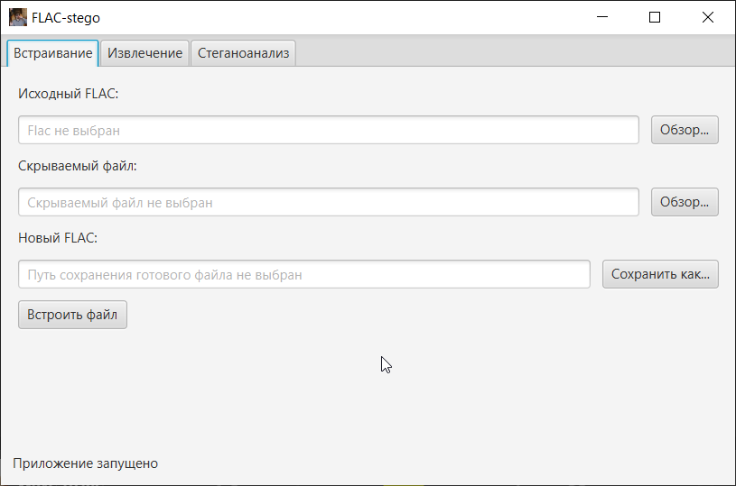
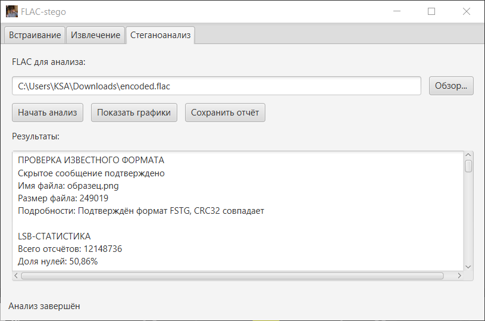
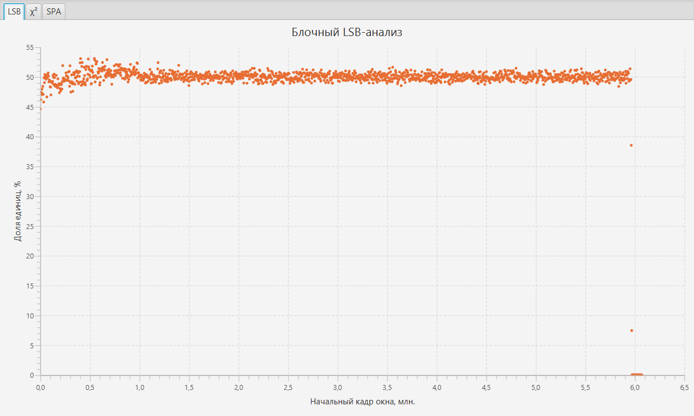

# FLAC-stego


Приложение для стеганографического встраивания и извлечения
файлов в аудиоконтейнерах FLAC с использованием
пространственно-временного метода LSB.

Проект также включает набор статистических методов
стегоанализа для исследования аудиофайлов.

## Возможности

- Встраивание произвольных файлов в FLAC.
- Извлечение скрытых файлов.
- Проверка целостности скрытых данных с помощью CRC32.
- Статистический и поблочный стегоанализ.
- Графическое представление результатов анализа.
- Сохранение отчёта в TXT.

## Методы стегоанализа

- Обнаружение скрытых сообщений известного формата.
- Статистика младших битов (LSB).
- Энтропия младших битов.
- Критерий хи-квадрат (χ²).
- Корреляционный анализ.
- Sample Pair Analysis (SPA).
- Поиск предполагаемой границы области встраивания.

Статистические методы позволяют выявлять возможные
признаки встраивания, но не гарантируют обнаружение
скрытых данных.

## Интерфейс

Приложение содержит три основные вкладки:
встраивание, извлечение и стегоанализ.







## Системные требования

- Java 21.
- Windows, Linux или macOS.

## Запуск

Скачайте JAR-файл для своей операционной системы
из раздела Releases.

| Платформа | Сборка |
|---|---|
| Windows x64 | windows-x64.jar |
| Linux x64 | linux-x64.jar |
| macOS Intel | macos-x64.jar |
| macOS Apple Silicon | macos-arm64.jar |

Пример запуска для Windows:

```bash
java -jar flac-stego-1.0.0-windows-x64.jar
```

Сборки проверены.

## Сборка из исходного кода

Для сборки необходимы JDK 21 и Maven.

```bash
mvn clean package -DskipTests -Djavafx.target=linux
```

Доступные значения `javafx.target`:

- `linux` — Linux x64;
- `win` — Windows x64;
- `mac` — macOS Intel;
- `mac-aarch64` — macOS Apple Silicon.

Готовый JAR-файл находится в каталоге `target/`.

## Используемые технологии

- Java 21
- JavaFX
- Apache Maven
- libflac-java

## О проекте

Практическая часть практической работы по теме: "Стеганографическое встраивание информации в произвольный аудиофайл формата FLAC с использованием пространственно-временого метода замены наименее значимых бит (LSB). Поиск подходов к выявлению скрытого содержимого с использованием методов стегонализа" 